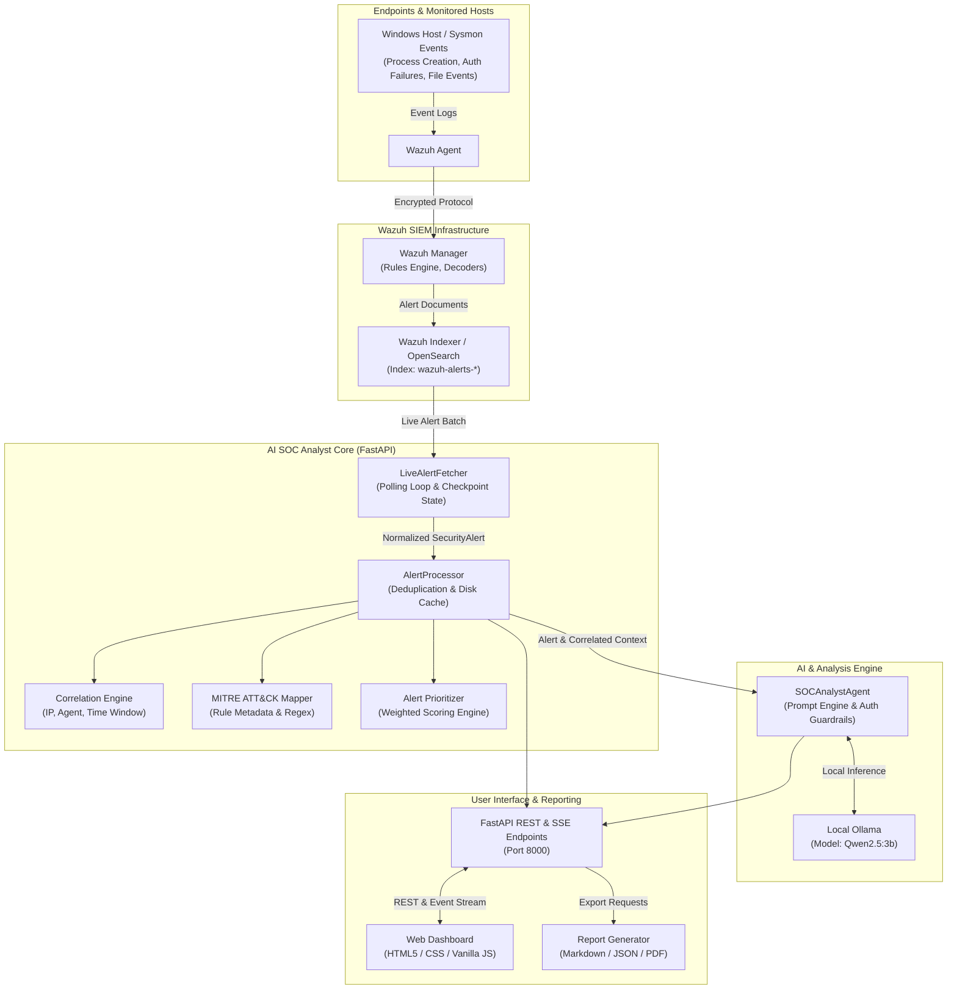

# AI-SOC-ASSISTANT-LIVE

[](https://www.python.org/)
[](https://fastapi.tiangolo.com/)
[](https://wazuh.com/)
[](https://opensearch.org/)
[](https://ollama.ai/)
[](https://www.langchain.com/)

**AI-SOC-ASSISTANT-LIVE** is an autonomous, AI-powered Security Operations Center (SOC) analyst agent designed to process, investigate, and contextualize security events generated by **Wazuh** and the **Wazuh Indexer (OpenSearch)** in real time. 

Built with **FastAPI**, **LangChain**, and local **Ollama** (`Qwen2.5:3b`), the system continuously monitors live SIEM telemetry, translates raw forensic logs into structured attack narratives, correlates related events into unified multi-stage incidents, maps activities to the MITRE ATT&CK framework, and delivers automated remediation recommendations via an interactive web dashboard and multi-format incident reports.

GitHub Repository: [https://github.com/Navleen3127-Kaur/AI-SOC-ASSISTANT-LIVE](https://github.com/Navleen3127-Kaur/AI-SOC-ASSISTANT-LIVE)

---

## Table of Contents

- [Key Capabilities](#key-capabilities)
- [Architecture](#architecture)
- [Modes of Operation](#modes-of-operation)
- [Prerequisites](#prerequisites)
- [Windows Quick Start](#windows-quick-start)
- [Live Production Configuration](#live-production-configuration)
- [Ollama & LLM Configuration](#llm-configuration)
- [Web Dashboard & Incident Workflow](#web-dashboard--incident-workflow)
- [CLI Reference](#cli-reference)
- [API Reference](#api-reference)
- [Security & Privacy Considerations](#security--privacy-considerations)
- [Project Structure](#project-structure)
- [Testing & Verification](#testing--verification)

---

## Key Capabilities

- **Continuous Live Alert Ingestion**: `LiveAlertFetcher` continuously polls the Wazuh Indexer (`OpenSearch`) on configurable intervals with persistent checkpointing to prevent alert loss across restarts.
- **Context-Aware AI Threat Triage**: Generates plain-language executive threat summaries, technical root-cause analyses, operational impact assessments, and detailed attack narratives using local LLMs.
- **Evidence-Based Authentication Guardrails**: Built-in validation ensures that failed authentications (e.g., Windows Event ID 4625 / OpenSSH logons) are never prematurely dismissed as "normal security events" or falsely declared "confirmed brute-force" without supporting telemetry.
- **Deterministic & Enriched MITRE ATT&CK Mapping**: Maps alerts to MITRE tactics and techniques directly from native Wazuh rule metadata (`rule.mitre.id`) and regex pattern matching, without hallucinated technique IDs.
- **Dynamic Alert Prioritization**: Computes a priority score (0–100) and severity rating (`CRITICAL`, `HIGH`, `MEDIUM`, `LOW`, `INFO`) based on Wazuh rule level, MITRE impact, asset exposure, and extracted threat indicators.
- **Multi-Event Incident Correlation**: Correlates alerts sharing common source IPs, usernames, or tight time windows into cohesive security incidents across Windows endpoints.
- **IOC Extraction & Intelligence Enrichment**: Uses regex-based IOC extraction for IPs, hashes, URLs, and domains with optional integrations for VirusTotal and AbuseIPDB.
- **Interactive SOC Investigation Dashboard**: A dark-mode, single-page web console featuring real-time alert queues, IOC breakdowns, analyst notes, live chat with the SOC AI agent, and incident status tracking (`New`, `In Progress`, `Closed`).
- **Comprehensive Incident Reporting**: Automatically compiles structured incident response reports exportable in **Markdown**, **JSON**, and **PDF** formats.

---

## Architecture

The following diagram illustrates the complete data flow from endpoint telemetry down to AI analysis and dashboard presentation:



---

## Modes of Operation

The system explicitly supports two modes:

| Feature | Live Mode | Demo Mode |
| :--- | :--- | :--- |
| **Data Source** | Real Wazuh Indexer (`wazuh-alerts-*` via OpenSearch) | Hardcoded synthetic alerts (brute force, PowerShell, ransomware) |
| **Prerequisites** | Wazuh Indexer running and reachable | None (standalone offline mode supported) |
| **Alert Fetching** | Polling background task tracking index timestamps | In-memory synthetic event generator |
| **Checkpointing** | Persists cursor to `config/fetcher_checkpoint.json` | None |
| **Analysis Caching** | Persists results to `config/analysis_cache.json` | Temporary in-memory session |
| **Primary Use** | Real-time monitoring and production SOC operations | Offline demos, feature validation, and unit testing |

---

## Prerequisites

Before running the application, ensure the following components are installed:

- **Operating System**: Windows 10/11 or Linux.
- **Python**: Version **3.11 or higher** (Python 3.14 compatible).
- **Git**: Installed and available in your environment path.
- **Wazuh Indexer**: An accessible Wazuh Indexer (OpenSearch 2.x) instance with network connectivity to port `9200`.
- **Ollama**: Local Ollama server installed and serving the configured model.

---

## Windows Quick Start

Open **PowerShell** and execute the following commands:

### 1. Clone the Repository & Enter Workspace
```powershell
git clone https://github.com/Navleen3127-Kaur/AI-SOC-ASSISTANT-LIVE.git
cd AI-SOC-ASSISTANT-LIVE
```
*(If working with an existing local directory, navigate into `C:\Users\navle\Desktop\soc_live`)*

### 2. Create and Activate Virtual Environment
```powershell
python -m venv .venv
.\.venv\Scripts\Activate.ps1
```

### 3. Install Dependencies
```powershell
python -m pip install --upgrade pip
pip install -e .
```

### 4. Setup Environment File
Copy the example environment configuration:
```powershell
Copy-Item .env.example .env
```

### 5. Pull and Verify Local Ollama Model
Ensure Ollama is running and download the model:
```powershell
ollama pull Qwen2.5:3b
```
Verify the model is listed:
```powershell
ollama list
```

### 6. Start the Application
Run the FastAPI application server:
```powershell
soc-analyst serve
```

Access the web interface at **`http://localhost:8000`** and the interactive API documentation at **`http://localhost:8000/docs`**.

---

## Live Production Configuration

To connect the application to your live Wazuh deployment, edit the `.env` file with your specific network parameters.

> [!WARNING]
> Always use environment variables or a local `.env` file for secrets. **Never commit actual credentials, passwords, or tokens to version control.**

### Wazuh Indexer Configuration Variables

| Variable | Description | Default Example |
| :--- | :--- | :--- |
| `WAZUH_INDEXER_URL` | Base HTTPS/HTTP URL of the Wazuh Indexer | `https://127.0.0.1:9200` |
| `WAZUH_USERNAME` | Read-authorized indexer username | `admin` |
| `WAZUH_PASSWORD` | Indexer account password | `YOUR_INDEXER_PASSWORD` |
| `WAZUH_INDEX_PATTERN` | Index pattern where alerts are written | `wazuh-alerts-*` |
| `VERIFY_SSL` | Verify TLS certificates (set `false` for self-signed) | `false` |
| `POLLING_INTERVAL` | Polling frequency in seconds for new alerts | `5` |
| `MIN_ALERT_LEVEL` | Minimum Wazuh rule level to ingest (1–15) | `4` |
| `LIVE_ALERT_STARTUP_LOOKBACK_MINUTES` | Initial query window on startup | `30` |

### General API Settings

| Variable | Description | Default |
| :--- | :--- | :--- |
| `API_HOST` | Host binding interface | `0.0.0.0` |
| `API_PORT` | Listening TCP port | `8000` |
| `ALERT_POLL_INTERVAL_SECONDS` | Background poller cadence | `10` |
| `MAX_ALERTS_PER_BATCH` | Maximum alerts fetched per cycle | `50` |
| `INCIDENT_TIME_WINDOW` | Time window (seconds) for event correlation | `7200` |
| `DISABLE_MITRE_ONLINE_LOOKUP`| Prefer local rule metadata over online lookups | `true` |

---

## LLM Configuration

The application supports both local offline inference (default) and external cloud providers.

### Local Ollama Setup (Recommended for Data Privacy)
```env
LLM_PROVIDER=ollama
OLLAMA_BASE_URL=http://localhost:11434
OLLAMA_MODEL=Qwen2.5:3b
```
- **Privacy Advantage**: Endpoint logs, user accounts, and hostnames remain strictly within your local environment.
- **Verification**: Ensure the Ollama background daemon is running by testing `http://localhost:11434/api/tags` in your browser or terminal.

### OpenAI Setup (Optional)
```env
LLM_PROVIDER=openai
OPENAI_API_KEY=your-openai-api-key-here
OPENAI_MODEL=gpt-4o-mini
```

> [!CAUTION]
> Using external cloud LLMs transmits raw SIEM telemetry (including usernames, internal IP addresses, process command lines, and hostnames) across the Internet. Sanitize production logs or verify data governance compliance before enabling external providers.

---

## Web Dashboard & Incident Workflow

Open your browser to `http://localhost:8000` to interact with the analyst console:

1. **Operation Mode Switcher**: Toggle between **LIVE** (real-time Wazuh alerts) and **DEMO** (test scenarios).
2. **Prioritized Alert Feed**: View incoming alerts ranked by calculated risk score (`CRITICAL`, `HIGH`, `MEDIUM`, `LOW`, `INFO`).
3. **Executive Threat Summary & Narrative**: Inspect AI-generated explanations and evidence breakdowns for any alert.
4. **MITRE ATT&CK Matrix**: Visual display of observed tactics and mapped technique IDs.
5. **IOC Extraction**: Extracted IP addresses, hashes, and domains with one-click reputation lookups.
6. **SOC AI Chat Assistant**: Ask ad-hoc questions about the selected incident directly from the dashboard sidebar.
7. **Incident Report Generation**: Download reports in **Markdown**, **JSON**, or **PDF** with single-click export buttons.

---

## CLI Reference

The project provides a command-line interface via `soc-analyst`:

```bash
# Start the web server and live background triage engine
soc-analyst serve

# Run interactive alert correlation over recent events
soc-analyst correlate --hours 24

# Monitor live alert stream in the terminal
soc-analyst watch

# Display current prioritized alert queue
soc-analyst prioritize --limit 20

# Analyze a specific alert by ID
soc-analyst analyze --alert-id <ALERT_ID>

# Run standalone demo analysis (no Wazuh connection required)
soc-analyst analyze --demo

# Generate a synthetic incident report in markdown
soc-analyst report --demo -o reports/incident.md
```

---

## API Reference

The FastAPI service exposes the following endpoints:

### System & Settings
- `GET /health` — Check system status, Elasticsearch/OpenSearch health, and active LLM provider.
- `GET /api/settings` — Retrieve current configuration (with masked credentials).
- `POST /api/settings` — Update runtime configuration parameters.

### Alerts & Triage
- `GET /alerts/prioritized` — Fetch ranked alerts with optional `limit` and `mode` (live or demo).
- `POST /alerts/search` — Query alerts across specific time ranges and rule levels.
- `POST /alerts/analyze` — Submit an alert payload for real-time AI triage.
- `GET /alerts/{alert_id}/analysis` — Retrieve cached or freshly computed analysis for an alert.
- `GET /stream/alerts` — Server-Sent Events (SSE) stream delivering real-time alert updates.

### Incidents & Investigation
- `GET /incidents/correlated` — Get correlated incident clusters grouped by entity and time.
- `POST /api/incidents/{incident_id}/status` — Update incident status (`New`, `In Progress`, `Closed`).
- `POST /incidents/report` — Synthesize an incident report for specified alert IDs.
- `POST /api/reports/download` — Export an incident report in `markdown`, `json`, or `pdf`.
- `POST /chat` — Conversational interface with the SOC Analyst agent.
- `GET /api/iocs/enrich` — Threat intelligence enrichment for an IOC value.
- `GET /mitre/search` — Search MITRE techniques.
- `GET /mitre/map/{alert_id}` — View mapped MITRE techniques for an alert.

### Demo & Test Endpoints
- `POST /demo/analyze` — Seed and trigger the pre-configured demo attack sequence.
- `POST /demo/reset` — Reset demo state and flush demo alert caches.

---

## Security & Privacy Considerations

1. **Protect Environment Secrets**:
   The `.env` file contains sensitive SIEM credentials and API keys. Keep `.env` listed in `.gitignore` and distribute only `.env.example` containing non-functional placeholders.
2. **Restrict SIEM Indexer Access**:
   Ensure the Wazuh Indexer (port `9200`) is secured with TLS, strong credentials, and firewall rules restricting access exclusively to the SOC host.
3. **Data Residency & Log Sanitization**:
   When using local Ollama models (`Qwen2.5:3b`), your security logs remain on-premise. If configuring an external API provider (such as OpenAI), ensure company security policies permit transmission of security telemetry to cloud APIs.
4. **No Destructive Actions**:
   The SOC Analyst agent provides evidence-based remediation guidance (e.g., verifying hashes, checking parent processes, checking digital signatures). It does not execute destructive host isolation or file deletion automatically without operator review.

---

## Project Structure

```
AI-SOC-ASSISTANT-LIVE/
├── config/
│   ├── analysis_cache.json        # Persistent cache of completed alert analyses
│   ├── fetcher_checkpoint.json    # Poller timestamp cursor for Wazuh alerts
│   ├── seen_ids.txt               # Ingested alert deduplication tracking
│   └── settings.yaml              # Default configuration settings
├── src/
│   └── soc_analyst/
│       ├── agents/
│       │   ├── llm_factory.py     # Provider abstraction (Ollama / OpenAI)
│       │   ├── prioritizer.py     # Weighted alert scoring engine
│       │   └── soc_analyst.py     # Main LangChain agent & authentication guardrails
│       ├── api/
│       │   └── app.py             # FastAPI routes, middleware, and dashboard endpoints
│       ├── connectors/
│       │   ├── elasticsearch_client.py  # OpenSearch/Elasticsearch client wrapper
│       │   └── wazuh_client.py          # Optional Wazuh Manager REST API client
│       ├── mitre/
│       │   └── attack_mapper.py   # MITRE ATT&CK technique mapping engine
│       ├── models/
│       │   └── schemas.py         # Pydantic data schemas and incident models
│       ├── services/
│       │   ├── alert_processor.py      # Alert triage manager & cache coordination
│       │   ├── correlation.py          # Multi-alert incident correlation logic
│       │   ├── forensic_extractor.py   # Windows/Sysmon log parser
│       │   ├── ioc_extractor.py        # Regex-based IOC extraction & enrichment
│       │   ├── live_alert_fetcher.py   # Continuous Wazuh indexer poller
│       │   └── report_generator.py     # Markdown and PDF incident report generators
│       └── templates/
│           └── incident_report.md.j2   # Jinja2 template for incident documentation
├── static/
│   └── index.html                 # Single-page SOC analyst web dashboard
├── tests/                         # Pytest automated test suites
├── .env.example                   # Safe template for environment variables
├── docker-compose.yml             # Optional containerized ELK & Wazuh stack
├── Dockerfile                     # Container definition for soc-analyst service
├── pyproject.toml                 # Package configuration & dependencies
└── README.md                      # Project documentation
```

---

## Testing & Verification

The project includes unit and integration tests verifying all core components, including the authentication guardrails and live ingestion pipeline.

Run the test suite using `pytest`:

```powershell
# Run the complete test suite
pytest -v

# Run authentication guardrail tests
pytest tests/test_auth_failure_fixes.py -v

# Run incident pipeline and correlation tests
pytest tests/test_incident_pipeline.py tests/test_correlation.py -v
```

### Verified Test Coverage
- **Authentication Failure Guardrails**: Validates that single failed SSH logons are classified neutrally, without unevidenced "normal security event" or premature "brute force" claims.
- **Brute-Force & Multi-Failure Scenarios**: Validates that repeated failed attempts or multiple targeted accounts are accurately identified with appropriate risk levels.
- **MITRE Mapping Consistency**: Verifies that technique IDs from Wazuh alert metadata are preserved without hallucinated technique overrides.
- **Incident Report Rendering**: Validates clean generation of Markdown and PDF reports.
